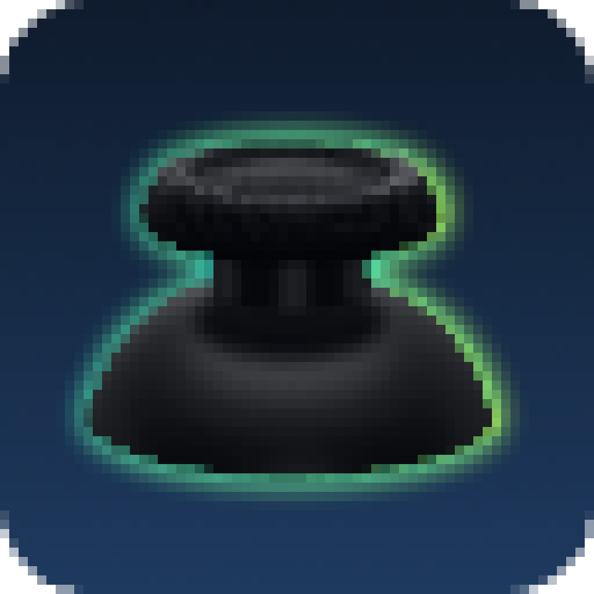
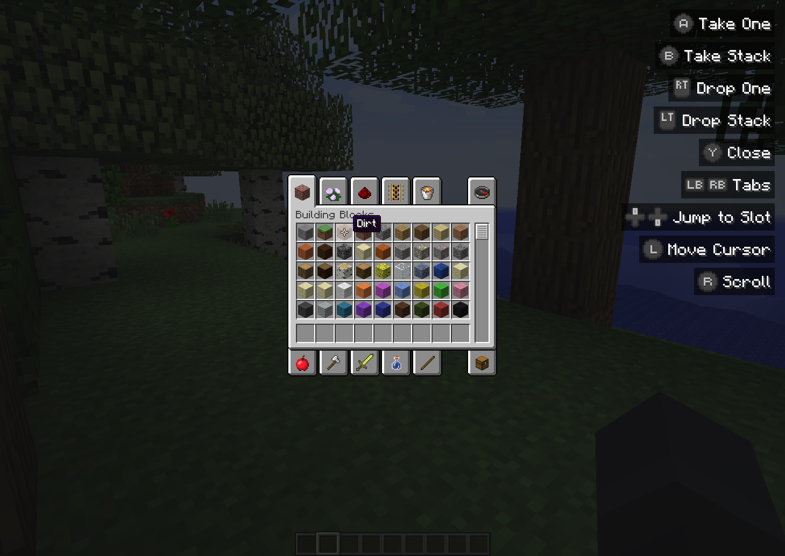
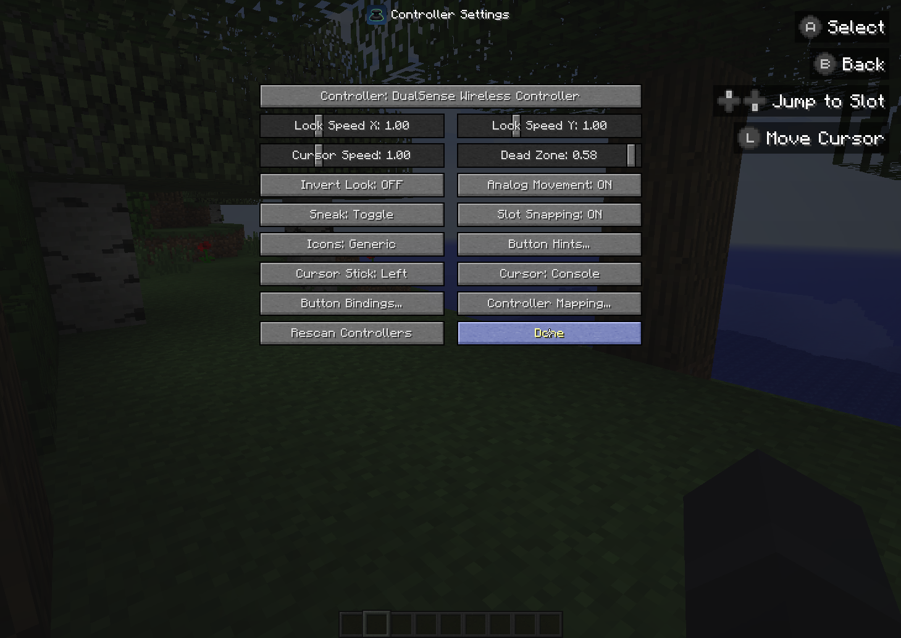

<p align="center"></p>

<h1 align="center">Thumbstick</h1>

<p align="center">A Controller Support Mod for Minecraft Forge 1.7.10.</p>

<p align="center">
  <a href="https://github.com/R-Besson/Thumbstick/releases"></a>
  <a href="https://www.curseforge.com/minecraft/mc-mods/thumbstick"></a>
  <a href="https://github.com/R-Besson/Thumbstick/releases"></a>
</p>

[//]: # (  <a href="https://modrinth.com/mod/thumbstick"></a>)

## Features

- **Analog movement and camera** with a radial dead zone and an ease in look curve
- **Works in every menu, modded ones too.** A controller cursor acts as the mouse and buttons become clicks
- **Inventory controls:** take, split and quick move, slot snapping, dpad slot navigation, creative tabs and scrolling
- **Rebindable buttons**, and any key binding (vanilla or modded) can get a controller button
- **Button hints** for every control, shown only while the controller is in use. Size, corner, detail and layout are configurable
- **Built in layouts** for Xbox, DualShock 4, DualSense and Switch Pro controllers, plus a **mapping wizard** for anything else
- **Hot plugging** with connect and disconnect notifications

<p align="center"></p>

> [!NOTE]
> Thumbstick is **client side only**. It does nothing on servers.

## Settings

Open **Options → Controls → Controller Settings...** (or **Mods → Thumbstick → Config**). From there you can pick the controller, tune sensitivity, edit **Button Bindings** and run **Controller Mapping**.

> [!TIP]
> If buttons are wrong or a toast says *Unknown layout*, run **Controller Mapping**. It asks for each button in turn and works with any gamepad.

Settings are saved in `config/thumbstick/`:

| File | Contents |
| --- | --- |
| `thumbstick.cfg` | Options and button bindings |
| `mappings.properties` | Layouts made with the mapping wizard |

<p align="center"></p>

## How it works

Input is read through **JInput**, which ships with Minecraft 1.7.10, so no native libraries are bundled. If JInput is unavailable, LWJGL's `Controllers` API is used instead.

Gameplay actions press the vanilla key bindings, so other mods see controller input as normal key presses. In menus the cursor position is written into LWJGL's mouse state instead of moving the OS cursor, which avoids coordinate mismatches under Windows display scaling.

On Windows a background thread checks the HID device list every second through Raw Input and only scans with DirectInput again when that list changes. Each DirectInput scan leaks a few dozen OS handles inside DirectInput itself, so it must not run on a timer.

> [!WARNING]
> On Linux, JInput needs read access to `/dev/input/event*`. Without it no controller is found.

> [!IMPORTANT]
> Outside Windows, controllers plugged in after launch are only picked up for a while after a disconnect, or with **Rescan Controllers** in the settings.

## Building

```bash
./gradlew build
```

The jar ends up in `build/libs/`.

## Credits

Inspired by [Controllable](https://github.com/MrCrayfish/Controllable) by MrCrayfish. Button icons and cursors come from it (MIT License, see `assets/thumbstick/textures/gui/LICENSE_Controllable.txt`).
